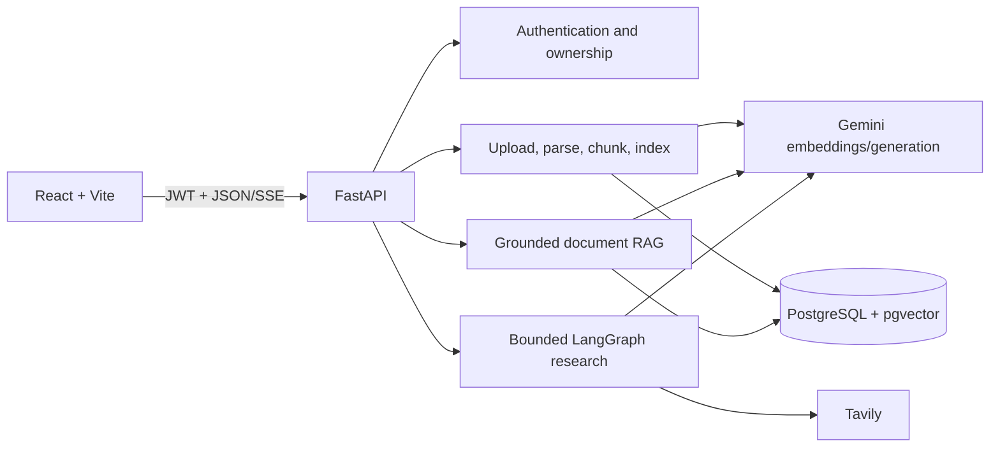
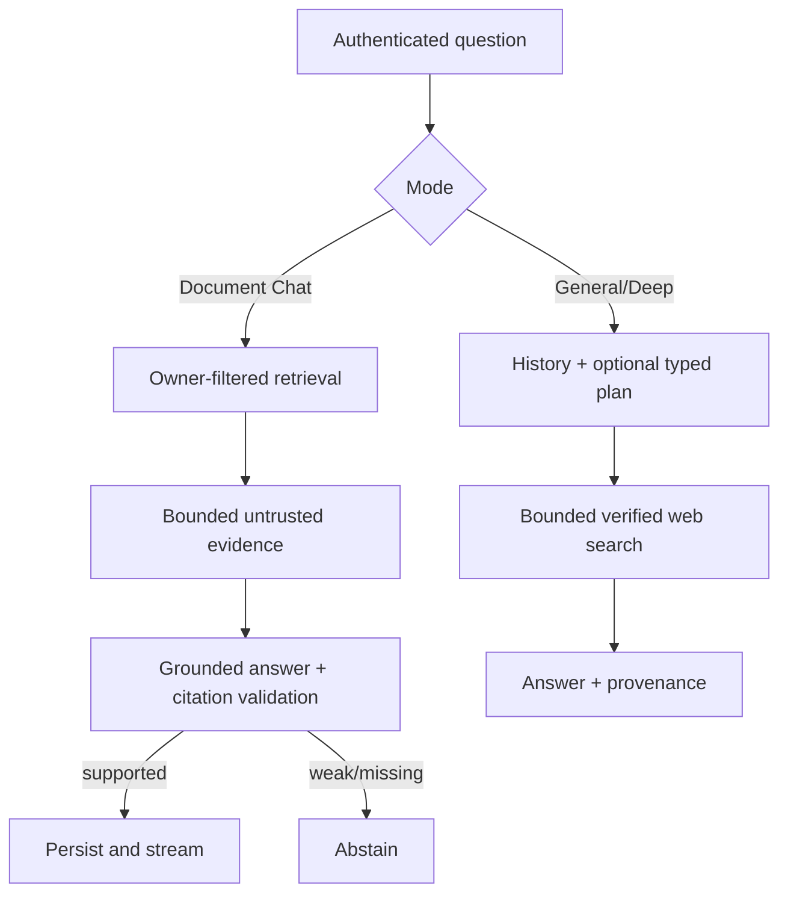

# AI Research Assistant

A locally runnable, authenticated research application that combines grounded
document question answering with bounded web research. It uses FastAPI,
React 19, PostgreSQL/pgvector, LangGraph, Gemini, and Tavily while preserving
user ownership, citations, safe abstention, and cost controls.

This is a portfolio and local-development project. It has not been deployed or
operated in production.

## Features

- JWT signup, login, refresh, logout, and user-scoped conversation history.
- Streaming PDF, DOCX, and TXT upload with safe storage, parsing, metadata,
  persistence, and deletion.
- Explicit manual indexing with structure-aware chunking, conservative PDF
  header/footer removal, normalized 1536-dimensional Gemini embeddings,
  bounded retries/concurrency, and atomic chunk replacement.
- Owner-filtered pgvector cosine retrieval and optional document selection.
- Grounded document answers with page citations, excerpts, strict source-label
  validation, and abstention when evidence is insufficient.
- General Chat with bounded persisted history and verified Tavily provenance.
- Opt-in Deep Research with a typed plan and search, iteration, and time limits.
- Source-quality notes, conservative numeric conflict detection, structured
  answer views, SSE streaming, and a private content-free usage dashboard.

## Architecture





Backend code is in `src/search_engine`, React in `frontend`, revisions in
`alembic/versions`, and detailed RAG design in `src/search_engine/rag/README.md`.

## Local setup

Requirements: Python 3.14, uv, Node/npm, PostgreSQL with pgvector, and Gemini
and Tavily keys for real provider calls. Automated tests make no paid calls.

1. Copy `.env.example` to `.env`, replace placeholders, and generate a random
   JWT secret of at least 32 characters. Never commit `.env`.
2. Create the configured database/role and make pgvector available.
3. Install dependencies and inspect migrations:

   ```powershell
   uv sync
   uv run python -m alembic current
   uv run python -m alembic heads
   uv run python -m alembic upgrade head --sql
   ```

4. Only with approval for the target database, apply and start the API:

   ```powershell
   uv run python -m alembic upgrade head
   uv run uvicorn src.search_engine.api:app --reload
   ```

5. Start the frontend:

   ```powershell
   cd frontend
   npm ci
   npm run dev
   ```

Open `http://127.0.0.1:5173/`. Vite proxies `/api` and `/chat` to port 8000.

## Configuration

`.env.example` is the complete template.

| Group | Variables | Purpose |
|---|---|---|
| Providers | `GEMINI_API_KEY`, `TAVILY_API_KEY` | Models, embeddings, web search |
| Database | `DB_*` | SQLAlchemy and Alembic connection |
| Auth/browser | `JWT_*`, token expirations, `CORS_ALLOWED_ORIGINS` | HS256 tokens and origins |
| Upload/parser | `RAG_STORAGE_DIR`, upload/DOCX/PDF limits | Storage and resource safety |
| Indexing | `RAG_EMBEDDING_*`, `RAG_INDEXING_MAX_CHUNKS` | Model, 1536d vectors, retries |
| RAG | `RAG_RETRIEVAL_*`, `RAG_ANSWER_*`, `RAG_FULL_CONTEXT_*` | Evidence/model budgets |
| Research | `GENERAL_CHAT_*`, `RESEARCH_*` | History, planning, search, timeout |
| Usage | `USAGE_*` | Process-local ceilings and retention |

Document embeddings use `RETRIEVAL_DOCUMENT`, query embeddings use
`RETRIEVAL_QUERY`, and both are L2-normalized. Changing model, dimensions,
normalization, or preprocessing requires re-indexing existing documents.

## Authentication and ownership

Signup stores a bcrypt hash. Login returns typed access and refresh JWTs.
Protected routes derive identity only from the Bearer access token; repository
queries enforce ownership for conversations, documents, chunks, indexing,
retrieval, and metrics. Logout currently clears client tokens but does not
revoke issued stateless JWTs. See `docs/security-review.md`.

## Document workflow

1. Upload a PDF, DOCX, or TXT document. Upload only parses and stores it.
2. Inspect its state, then choose **Prepare for AI questions** and confirm. This
   explicit action invokes embedding work.
3. Indexing removes verified repeated PDF margin boilerplate, chunks text,
   embeds it, and atomically replaces prior chunks.
4. Select ready documents in Document Chat, or select none to search all ready
   documents owned by the current user.

The server streams uploads (100 MiB default), bounds DOCX expansion and chunk
count, and never returns internal storage paths.

## Chat and research modes

- **General Chat** uses bounded history and may search the web for current or
  missing facts.
- **Document Chat** uses only authenticated document evidence. One small
  document may use bounded full context; otherwise pgvector retrieval is used.
  It never silently falls back to web search.
- **Deep Research** explicitly creates bounded typed subquestions and runs
  deduplicated searches within configured call, iteration, and time budgets.

Web and document text are untrusted evidence, not instructions. Only structured
tool results become web citations; model-invented URLs are discarded. Source
notes are explainable signals, not authority scores.

## SSE protocol

`POST /chat/stream` returns `text/event-stream` with JSON data events:

```text
data: {"conversation_id":"..."}

data: {"delta":"partial answer"}

data: {"mode":"general","web_citations":[],"research_plan":[],"research_summary":{...}}

data: {"done":true,"conversation_id":"..."}
```

Errors use `{"error":"safe message"}`. Document mode emits one completed-answer
delta plus citation/status metadata; it does not claim token-level streaming.

## API contracts

| Method | Path | Purpose |
|---|---|---|
| `POST` | `/api/auth/signup`, `/login`, `/refresh`, `/logout` | Auth lifecycle |
| `GET` | `/api/auth/me` | Current public profile |
| `GET` | `/api/conversations/latest` | Restore latest owned chat |
| `POST` | `/api/documents/upload` | Upload and parse |
| `GET` | `/api/documents`, `/api/documents/{id}` | Owned document metadata |
| `DELETE` | `/api/documents/{id}` | Delete owned document |
| `POST` | `/api/documents/{id}/index` | Explicit indexing |
| `POST` | `/chat`, `/chat/stream` | JSON or SSE chat |
| `GET` | `/api/metrics` | Private process-local metrics |

Chat bodies contain `query`, `mode`, optional `conversation_id`, document IDs
only in document mode, and `research_mode` only in general mode.

## Security and cost controls

- Explicit CORS allowlist, HS256-only JWT configuration, and owner-filtered
  queries with not-found behavior for cross-user resources.
- Filename/MIME/extension checks and upload, archive, chunk, query, context,
  search, timeout, concurrency, and daily-request bounds.
- HTTP(S)-only evidence URLs, escaped React Markdown, no raw HTML, and
  `noopener noreferrer` external links.
- Prompt-injection boundaries, safe provider errors, and validation logs that
  omit submitted values.
- Manual indexing confirmation and metrics that retain no prompt, answer,
  document text, token, or user identifier.

These are local defense-in-depth controls, not a production certification.

## Testing and evaluation

```powershell
uv run pytest -q
cd frontend
npm test
npm run lint
npm run build
```

Backend tests cover auth, ownership/IDOR, upload/parsing, manual and atomic
indexing, embeddings, retrieval metrics, citations, abstention, injection,
research budgets/failures, structured answers, observability, and security.
Frontend tests cover mode/payload isolation, attachments, SSE metadata, file
validation, and safe links; lint/build validate the full UI.

Committed golden fixtures are synthetic. The private real benchmark has not
been populated or run. Use `docs/evaluation-protocol.md` to label user-owned
English and Arabic cases without committing private content or inventing scores.

## Known limitations

- Real Gemini/Tavily quality, quota, and latency checks require manual approval.
- No private human-labeled benchmark results exist yet.
- Usage limits are per process; refresh tokens have no durable revocation;
  browser tokens use localStorage; parsers are not malware-sandboxed.
- No hybrid retrieval, reranker, HNSW, answer cache, or automatic re-indexing.
- Structured views are derived locally, avoiding a second paid model call.
- LangGraph `create_react_agent` and an upstream Google Python type alias emit
  deprecation warnings.

## More documentation

- `src/search_engine/rag/README.md` — RAG contracts and implementation notes
- `docs/evaluation-protocol.md` — private human evaluation workflow
- `docs/security-review.md` — reviewed controls and unresolved concerns
- `docs/portfolio-description.md` — accurate portfolio summary
